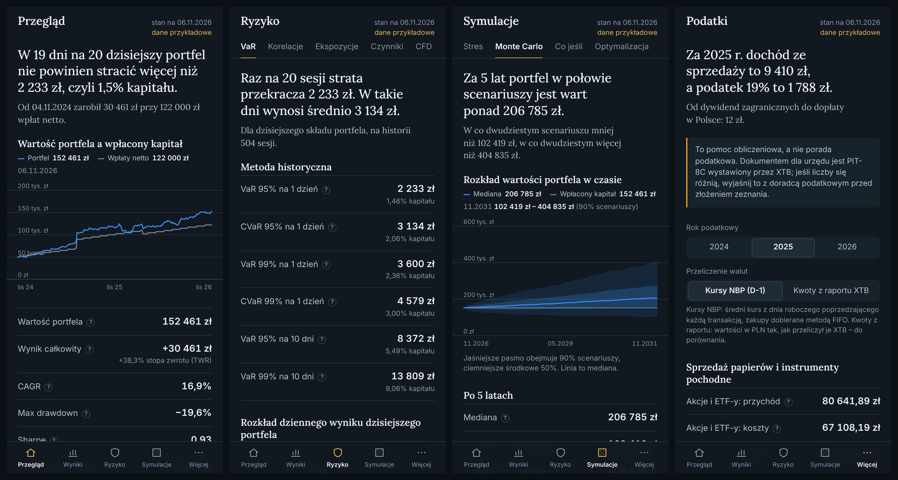

# XTB Analytics

Aplikacja na telefon do zaawansowanej analityki portfela dla klienta XTB. Wgrywasz eksport z xStation 5 i dostajesz
to, czego broker nie pokazuje: prawdziwą stopę zwrotu, ryzyko w złotówkach, stress testy, symulacje przyszłości,
analizę własnych nawyków i zestawienie do PIT-38.

Aplikacja jest wyłącznie analityczna. Nie loguje się do konta XTB, nie składa zleceń i nie daje rekomendacji
„kup / sprzedaj”.



## Co potrafi

| Dział | Co tam znajdziesz |
|---|---|
| **Przegląd** | 6 kluczowych liczb, krzywa kapitału na tle wpłat, obsunięcie, aktualny skład |
| **Wyniki** | TWR i XIRR, CAGR, Sharpe, Sortino, Calmar, obsunięcia, beta i alfa; porównanie z WIG20, WIG, S&P 500 i MSCI World w PLN; zwroty miesięczne; atrybucja wyniku na pozycje, sektory, kraje i waluty |
| **Ryzyko** | VaR i CVaR 95%/99% na 1 i 10 dni trzema metodami; korelacje i udział pozycji w ryzyku; ekspozycje i koncentracja; czynniki Fama-French; dźwignia i odległość do stop outu na CFD |
| **Symulacje** | Scenariusze 2008, marzec 2020, 2022 i własne; Monte Carlo na 1/5/10 lat; „co jeśli” przed transakcją; porównanie z portfelami modelowymi |
| **Rynki** (w „Więcej”) | Rentowności obligacji USA i krzywa (dziś, tydzień i miesiąc temu), spready; indeksy, VIX, waluty i surowce; kalendarz danych makro (głównie USA) |
| **Trader** (w „Więcej”) | Hit rate, payoff, profit factor, wzorce zachowań, kalkulator wielkości pozycji, koszty, reżimy rynku |
| **Podatki** (w „Więcej”) | Zestawienie do PIT-38: FIFO, kursy NBP, dywidendy zagraniczne; eksport do PDF i CSV |
| **AI** (opcjonalnie) | Memo ryzyka i pytania o portfel - pojawia się po ustawieniu klucza API |

Każda liczba ma objaśnienie prostym językiem: **dotknij wiersza**, żeby je rozwinąć.

Możesz wgrać **kilka rachunków XTB naraz** (np. w PLN i w USD), zaznaczać, które wliczać do portfela, i przełączać
**walutę wyświetlania** między PLN, USD i EUR - przyciskiem na pasku u góry ekranu.

Po uruchomieniu aplikacja pokazuje **dane przykładowe** (zmyślony portfel, syntetyczne notowania), więc możesz
obejrzeć wszystko, zanim wgrasz własny plik.

---

## Uruchomienie w chmurze (zalecane dla telefonu)

Aplikacja składa się z małego serwera w Pythonie (liczy) i strony, którą otwierasz w telefonie (pokazuje).
Najprościej postawić serwer na darmowym planie [Render](https://render.com).

Konta i zaszyfrowane portfele trzyma darmowa baza **Neon** (Postgres). Darmowy Render nie ma trwałego dysku,
a jego darmowa baza wygasa po 30 dniach, więc baza jest osobno.

**A. Baza Neon (raz, ok. 3 minuty)**

1. Wejdź na **neon.com**, załóż darmowe konto (bez karty) i utwórz projekt - region najlepiej
   **Europe (Frankfurt)**, blisko serwera Render.
2. W panelu projektu kliknij **Connect** i skopiuj **connection string** (zaczyna się od `postgresql://`
   i kończy `?sslmode=require`). To adres razem z hasłem do bazy - nie wklejaj go nigdzie poza Render.

**B. Serwer Render**

1. Załóż konto na **render.com** - najwygodniej przyciskiem „Sign in with GitHub”.
2. W panelu wybierz **New → Blueprint** i wskaż repozytorium `xtb-analytics`. Jeśli Render go nie widzi, kliknij
   „Configure account” i daj mu dostęp do tego repozytorium.
3. Render odczyta plik `render.yaml` i zapyta o wartości:
   - `DATABASE_URL` - wklej connection string z Neon.
   - `APP_PASSWORD` - **kod konfiguracji**: wymyśl długi ciąg znaków. Będzie potrzebny tylko raz, do założenia
     pierwszego konta (administratora). Dopóki konto nie istnieje, kod pilnuje, żeby nikt obcy go nie przejął.
   - `ANTHROPIC_API_KEY` - zostaw puste, chyba że chcesz włączyć dział AI (patrz niżej).
   - `SECRET_KEY` Render wygeneruje sam.
4. Kliknij **Apply**. Pierwsze budowanie trwa kilka minut. Na końcu dostaniesz adres w rodzaju
   `https://xtb-analytics-abcd.onrender.com`.
5. Otwórz ten adres i **od razu** załóż pierwsze konto: nazwa użytkownika, hasło (co najmniej 10 znaków, najlepiej
   kilka słów) i kod konfiguracji z punktu 3. Potem dodaj aplikację do ekranu głównego (następny rozdział).

Masz już działającą usługę z poprzedniej wersji? W Render otwórz usługę → **Environment** → dodaj `DATABASE_URL`
(z Neon) i `SECRET_KEY` (dowolny długi losowy ciąg) → **Save**. Obecne `APP_PASSWORD` stanie się kodem
konfiguracji. Po zalogowaniu pliki zapisane wcześniej w telefonie same przeniosą się do zaszyfrowanego sejfu.

**C. Konta dla innych osób**

W **Więcej → Dane i ustawienia → Ustawienia** administrator generuje **kod zaproszenia** (jednorazowy, ważny
7 dni) i przekazuje go osobie, która na ekranie logowania wybiera „Mam kod zaproszenia - załóż konto”.
Każde konto ma własny, osobno zaszyfrowany portfel; nikt - także administrator - nie widzi cudzych plików.
Administrator może usunąć cudze konto razem z jego sejfem.

Co warto wiedzieć o darmowym planie (stan na listopad 2026): usługa zasypia po 15 minutach bez ruchu i budzi się
przy następnym wejściu, co trwa do około minuty. Aplikacja otworzy się od razu z pamięci telefonu i pokaże
„Budzę serwer…”. Po przebudzeniu notowania pobierają się od nowa, więc pierwsze przeliczenie własnego portfela
potrwa dodatkowe kilkadziesiąt sekund.

### Instalacja na telefonie

- **iPhone (Safari):** otwórz adres aplikacji → przycisk Udostępnij → „Do ekranu początkowego”.
- **Android (Chrome):** otwórz adres → menu z trzema kropkami → „Zainstaluj aplikację” lub „Dodaj do ekranu głównego”.

Od tej chwili aplikacja ma własną ikonę i otwiera się na pełnym ekranie, bez paska przeglądarki.

## Uruchomienie na własnym komputerze

Potrzebny jest Python 3.11 lub nowszy ([python.org/downloads](https://www.python.org/downloads/); w Windows zaznacz
przy instalacji „Add Python to PATH”).

| System | Komenda |
|---|---|
| macOS / Linux | `./start.sh` albo `make run` |
| Windows | dwuklik na `start.bat` |

Skrypt przy pierwszym uruchomieniu tworzy środowisko i instaluje zależności (2-5 minut), a potem wypisuje dwa adresy:
`http://localhost:8000` (ten komputer) i adres w sieci domowej, np. `http://192.168.1.20:8000`. Ten drugi otworzysz
w telefonie podłączonym do tego samego Wi-Fi. W tym wariancie dane nie opuszczają Twojego sprzętu, ale komputer musi
być włączony, a instalacja ikony z trybem offline nie zadziała (przeglądarki wymagają do tego szyfrowanego adresu
`https://`).

Lokalnie konta trzymane są w pliku `.cache/accounts.sqlite` (bez `DATABASE_URL`). Przy pierwszym uruchomieniu załóż konto; jeśli ustawisz `APP_PASSWORD`, posłuży jako kod konfiguracji. Konfiguracja: skopiuj `.env.example` jako `.env` i uzupełnij.

---

## Jak wyeksportować pliki z xStation 5

1. Zaloguj się do **xStation 5** na komputerze (w przeglądarce albo w aplikacji).
2. Otwórz **Historię rachunku** (Account history) - zakładka nad wykresem, obok Edukacji, Kalendarza i Wiadomości.
3. Kliknij **Eksportuj** po prawej stronie i ustaw **pełny zakres dat** - od otwarcia rachunku do dziś.
4. Zapisz plik **XLSX**. Obecny xStation zapisuje jeden plik na rachunek, np. `USD_51672516_2006-01-01_2026-11-11.xlsx`,
   z trzema arkuszami: Closed Positions, Open Positions, Cash Operations. Starsze wersje zapisują trzy osobne
   raporty (także CSV) - aplikacja czyta oba układy.
5. **Masz kilka rachunków** (np. w PLN i w USD)? Przełącz rachunek w xStation i wyeksportuj każdy osobno.
6. W aplikacji wejdź w **Więcej → Dane i ustawienia** i wgraj pliki - wszystkie naraz albo po kolei. Aplikacja sama
   rozpozna rachunki (po numerze) i tabele (po nazwach kolumn, po polsku i po angielsku).

### Widok portfela: CFD i okres analizy

Przycisk na pasku u góry otwiera **Widok portfela** - ustawienia wspólne dla wszystkich ekranów:

- **Pomiń CFD** - zostają same akcje i ETF-y. Wynik CFD (zyski, straty, swapy) jest wtedy traktowany jak
  wpłata albo wypłata: gotówka dalej zgadza się z rachunkiem, ale CFD nie wpływają na stopy zwrotu,
  obsunięcia ani ryzyko. Przydatne, gdy CFD były epizodem, a oceniasz portfel akcyjny.
- **Okres analizy** - od początku, od początku roku, ostatnie 12/24/36 miesięcy albo **własny zakres dat**
  (od-do). Stan portfela z dnia przed początkiem okresu jest kapitałem startowym, więc wcześniejsza historia
  nie obciąża statystyk. Gdy ustawisz datę końcową, skład i ryzyko są liczone na ten dzień.
- Podatki zawsze liczą całą historię i wszystkie instrumenty.

Okres wybierzesz też **jednym kliknięciem z paska „Okres” nad treścią każdego ekranu** (Całość / YTD / 12M / 24M /
3L / Zakres dat…). Obok jest przełącznik „Bez CFD”.

### Miary funduszowe: statystyki, long/short, limity

Te same dane ułożone tak, jak raportuje je fundusz long/short:

- **Wyniki → Statystyki** - TWR, CAGR, XIRR, zmienność, Sharpe, Sortino, Calmar, beta, alfa, tracking error,
  information ratio, przechwytywanie wzrostów i spadków benchmarku, statystyki miesięcy i dni, tail ratio, omega,
  kroczący Sharpe / zmienność / beta oraz tabela największych obsunięć (szczyt, dołek, odrobienie).
- **Ryzyko → Long / short** - ekspozycja długa, krótka, brutto i netto jako część NAV, beta portfela z bet pozycji,
  ekspozycja sektorowa long vs short, wkład każdej pozycji w betę i **kalkulator zabezpieczenia bety**
  (jaki nominał krótkiej pozycji na indeksie sprowadza betę do wybranego poziomu).
- **Ryzyko → Limity** - monitor limitów ryzyka z własnymi progami: pozycja, sektor, top 5, ekspozycja brutto, VaR,
  obsunięcie, minimalna gotówka. Status: w normie / blisko / przekroczony.

### Nawigacja

Na dole telefonu (na komputerze: w bocznym panelu) jest pięć zakładek: **Przegląd, Spółki, Wyniki, Ryzyko, Więcej**.
W „Więcej” są: Symulacje, Trader, Podatki, AI (gdy włączone) oraz Dane i ustawienia. Ekran Ryzyko → CFD pokazuje
się tylko wtedy, gdy masz pozycje CFD. Okres analizy wybiera się wyłącznie paskiem „Okres” nad treścią.

### Wycena na dziś

Raport z xStation pokazuje stan z chwili eksportu. Aplikacja bierze z niego **skład portfela i gotówkę**, a wycenia
je **bieżącymi cenami i kursami na dzisiejszy dzień**. Na pasku u góry widać wtedy „wycena 12.11 · skład z 11.11”.
Transakcji, wpłat i dywidend po dacie raportu aplikacja nie zna - po każdej zmianie w portfelu wgraj nowy eksport.

### Tabele: sortowanie i eksport

Kliknięcie nagłówka kolumny sortuje tabelę (malejąco → rosnąco → kolejność wyjściowa). Pod tabelą jest
**Pobierz CSV** - plik otwiera się w Excelu (średnik jako separator, przecinek dziesiętny).

### Spółki: lista pozycji, raporty, wiadomości

Dział **Spółki** (druga zakładka na dolnym pasku) otwiera się na zakładce **Lista** - to codzienny rzut oka na portfel:

- **Twoje pozycje** - każda pozycja z bieżącą ceną, zmianą dzienną w procentach i w kwocie, wagą w portfelu,
  wynikiem od ceny zakupu, odległością od szczytu z 52 tygodni i datą najbliższego raportu. Kolejność: według
  wagi, zmiany dziennej albo terminu raportu. Wzrosty są zielone ze znakiem „+”, spadki czerwone.
- **Najbliższe raporty kwartalne i roczne** - data, za ile dni, którego kwartału dotyczy (według roku
  obrotowego spółki; Q4 to zarazem wyniki roczne), czy data jest potwierdzona, konsensus EPS i przychodów.
- **Nadchodzące dywidendy** - dzień bez prawa do dywidendy i termin wypłaty.
- **Wiadomości o spółkach** - najnowsze nagłówki (najwyżej 3 na spółkę) z odnośnikiem do wydawcy i filtrem spółki.

Notowania, terminy i nagłówki pochodzą z Yahoo Finance; notowania odświeżają się co 10 minut, wiadomości co
pół godziny, terminy co 12 godzin. Gdy bieżącej ceny nie da się pobrać, lista pokazuje ostatnie zamknięcie.
Lista jest zawsze „na dziś” - nie zależy od wybranego okresu analizy. Skład portfela pochodzi z ostatniego
eksportu z xStation, więc po transakcjach wgraj nowy plik.

Druga zakładka, **Wycena**, to odwrócony DCF opisany niżej.

### Rynki: stopy USA, notowania, kalendarz makro

Dział **Rynki** (pierwsza pozycja w „Więcej”) pokazuje sytuację na rynkach - niezależnie od portfela i od wybranego
okresu analizy (dlatego nie ma tu paska „Okres”):

- **Stopy USA** - krzywa rentowności obligacji skarbowych USA od 1 miesiąca do 30 lat: dziś, tydzień i miesiąc temu
  na jednym wykresie; tabela rentowności ze zmianami w punktach bazowych (dzień, tydzień, miesiąc, od początku
  roku, 12 miesięcy); spready 10 lat − 2 lata, 10 lat − 3 mies. i 30 lat − 5 lat; historia z 12 miesięcy.
- **Notowania** - główne indeksy (S&P 500, Nasdaq 100, Dow Jones, Russell 2000, Euro Stoxx 50, DAX, WIG20,
  Nikkei 225), VIX i VIX 3M, waluty (DXY, EUR/USD, USD/PLN, EUR/PLN, GBP/USD, USD/JPY, CHF/PLN), złoto i ropa Brent -
  ze zmianami w tych samych oknach i wykresami z 12 miesięcy.
- **Kalendarz** - zbliżające się publikacje makro na ten i przyszły tydzień, pogrupowane według dni, w czasie
  polskim, z prognozą i poprzednim odczytem. Domyślnie USA i dane ważne; filtry: USA / USA i Europa / wszystkie
  kraje oraz waga danych.

Źródła (bez kluczy API): krzywa - US Treasury (zapasowo FRED, a potem Yahoo), notowania - Yahoo Finance
(zapasowo Stooq), kalendarz - Forex Factory. Krzywa odświeża się co 3 godziny, notowania co 15 minut, kalendarz
co godzinę; gdy źródło nie odpowiada, widać ostatnią zapisaną wersję z ostrzeżeniem. W trybie demo dane są zmyślone.

### Spółki: odwrócony DCF, prognozy, ceny docelowe

Zakładka **Spółki** pokazuje dla wybranej akcji z portfela:

- **odwrócony DCF** - jaki roczny wzrost wolnych przepływów pieniężnych jest wpisany w dzisiejszą wycenę,
  z suwakami stopy dyskonta i wzrostu wiecznego oraz tabelą wrażliwości,
- zestawienie tego wzrostu z historią spółki i z prognozami analityków,
- przychody (historia i konsensus prognoz), przepływy operacyjne, wolne przepływy i zysk netto,
- ceny docelowe analityków: najniższą, średnią, najwyższą i ich odległość od ceny.

Dane pochodzą z Yahoo Finance (w trybie demo są zmyślone). To informacja, nie rekomendacja.

### Komputer

Na szerokim ekranie (od 1024 px) aplikacja przełącza się w układ stanowiskowy: boczny panel z całą nawigacją,
liczby w kafelkach, tabele na całą szerokość. Zysk jest zielony, strata czerwona.

### Kilka rachunków i waluta wyświetlania

- Każdy wgrany plik **dodaje się** do już wgranych. Nowszy eksport tego samego rachunku zastępuje starszy.
- Przycisk na pasku u góry (np. **„2 z 2 rachunków · PLN”**) otwiera wybór: które rachunki wliczać do portfela
  i w jakiej walucie pokazywać kwoty - **PLN, USD albo EUR**. Wybór jest pamiętany w telefonie.
- Przelewy między własnymi rachunkami („Currency conversion … from TA: … to: …”) nie są liczone jako wypłata
  i wpłata, gdy oba rachunki są zaznaczone. Różnica na kursie wymiany trafia do wyniku jako koszt.
- Gotówka w USD jest codziennie przeliczana po kursie NBP. Jej zmiana wartości w złotych to część wyniku
  (w atrybucji: efekt walutowy).
- Zmiana waluty wyświetlania przelicza wszystko: wartości, stopy zwrotu, benchmarki, ryzyko. Stopa zwrotu
  w dolarach i w złotych będzie inna - różni je zmiana kursu USD/PLN w tym czasie.
- **Podatki są zawsze w złotych** i obejmują tylko zaznaczone rachunki.

Ważne:

- **Operacje gotówkowe są obowiązkowe** i powinny obejmować całą historię rachunku. Z nich aplikacja odtwarza wpłaty,
  wypłaty, dywidendy i koszty. Niepełny zakres zaniży albo zawyży stopę zwrotu.
- Po wgraniu porównaj **Wartość portfela** (Więcej → Dane i ustawienia → Wczytane dane) z polem Equity w xStation
  z dnia eksportu. Jeśli się różnią, zwykle winny jest niepełny zakres dat albo zły ticker.
- Aplikacja porównuje cenę z notowań z ceną „Current price” z raportu XTB i ostrzega, gdy różnią się o ponad 8%
  (najczęściej zły ticker albo inna waluta notowań).
- Jeśli wycena którejś pozycji się nie zgadza, popraw ją w **Więcej → Dane i ustawienia → Tickery**. Dla CFD sprawdź tam
  też mnożnik i stawkę depozytu.
- Gdy plik nie zostanie rozpoznany, komunikat powie dokładnie, których kolumn brakuje.

Pliki zostają zapisane w telefonie. Kiedy zrobisz nowszy eksport, po prostu wgraj go - zastąpi starszy plik tego
samego rachunku. Rachunek usuniesz przyciskiem „Usuń” na liście rachunków.

---

## Jak czytać najważniejsze liczby

**Stopa zwrotu.** TWR mówi, jak radziły sobie Twoje decyzje, niezależnie od tego, kiedy dopłacałeś - tę liczbę
porównuj z indeksami. XIRR mówi, ile faktycznie zarobiły Twoje pieniądze; jeśli dużo dopłaciłeś tuż przed spadkiem,
będzie niższa od TWR.

**Obsunięcie (drawdown).** O ile procent portfel spadł od szczytu. To najuczciwsza miara tego, co trzeba było
wytrzymać. Liczone na stopie zwrotu, więc wpłaty go nie ukrywają.

**Sharpe, Sortino, Calmar.** Zwrot w relacji do ryzyka. Około 1 to dobry wynik, ale na dwóch latach historii te
wskaźniki mają dużą niepewność.

**VaR 95% na 1 dzień = 2 000 zł** znaczy: w 19 dni na 20 strata będzie mniejsza niż 2 000 zł. **CVaR** mówi, ile
średnio tracisz w tym jednym gorszym dniu. Jeśli trzy metody liczenia mocno się różnią, rynek ma „grube ogony”
i ostrożniej jest patrzeć na najwyższą wartość.

**Efektywna liczba zakładów.** 20 spółek, które chodzą razem, to w praktyce 2-3 zakłady. Niska wartość przy portfelu
samych akcji jest normalna - dominuje wspólny czynnik rynkowy.

**Udział w ryzyku.** Pozycja może ważyć 10% portfela, a odpowiadać za 30% jego wahań.

**Stress testy.** Co by się stało z dzisiejszym portfelem, gdyby rynki powtórzyły znany kryzys. Zwróć uwagę, że
osłabienie złotego w kryzysach amortyzuje straty na zagranicznych akcjach.

**Monte Carlo.** Wachlarz możliwych przyszłości, nie prognoza. Domyślnie zakłada 6% zwrotu rocznie, bo dwa lata
historii to za mało, żeby ufać średniej z przeszłości.

**Wzorce tradera.** Trzy typowe błędy: podbijanie stawki po stracie, trzymanie strat dłużej niż zysków i zbyt
wczesne zamykanie zyskownych pozycji. Sprawdź osobno zakres CFD i akcji.

**Podatki.** Zestawienie jest pomocą obliczeniową. Dokumentem dla urzędu jest PIT-8C od XTB; różnice wyjaśnij
z doradcą podatkowym.

Kolory: **niebieski to zysk, czerwony to strata** (para czytelna także dla osób, które słabo rozróżniają zieleń
i czerwień).

---

## Dział AI (opcjonalny)

Po ustawieniu `ANTHROPIC_API_KEY` w „Więcej” pojawia się dział **AI**: przycisk „Napisz memo ryzyka” (tygodniowy
raport w stylu risk managera) i czat odpowiadający na pytania o portfel.

- Klucz API założysz w Claude Console (instrukcja: [Get started with Claude](https://platform.claude.com/docs/en/get-started)). Na Render wpisz go w ustawieniach usługi
  (Environment), lokalnie w pliku `.env`. Korzystanie z API jest płatne wg cennika Anthropic.
- Do modelu trafiają **wyłącznie zagregowane metryki** i nazwy najważniejszych pozycji. Nie trafia tam imię
  i nazwisko, numer rachunku ani lista transakcji. Dokładną zawartość zobaczysz w aplikacji pod „Co dokładnie
  zostanie wysłane”, zanim cokolwiek wyślesz.
- Model można zmienić zmienną `ANTHROPIC_MODEL` (domyślnie `claude-sonnet-5-5`).
- Bez klucza aplikacja działa w pełni, tylko bez tego działu.

## Prywatność i bezpieczeństwo

**Hasło nie opuszcza telefonu.** Telefon wyprowadza z niego dwa klucze (PBKDF2-SHA256, 600 000 iteracji, potem
HKDF): klucz logowania, który trafia na serwer, i klucz szyfrowania, który zostaje w telefonie. Z pierwszego
nie da się odtworzyć drugiego.

**Portfel jest szyfrowany w telefonie** (AES-256-GCM), zanim trafi do bazy: pliki z xStation, ich nazwy (z numerem
rachunku), poprawki tickerów i ustawienia. W bazie Neon leżą tylko szyfrogramy. Ani Neon, ani Render, ani ktoś,
kto wykradnie bazę, nie odczyta portfela.

**Uczciwie o granicach:**
- Do obliczeń telefon wysyła odszyfrowane pliki na serwer na czas sesji (do 3 godzin). Serwer trzyma je wtedy
  wyłącznie w pamięci - nie zapisuje na dysk ani do bazy - i kasuje przy wylogowaniu. Kto przejąłby serwer
  w trakcie sesji, mógłby je zobaczyć. Pełne szyfrowanie „end-to-end” wymagałoby liczenia w telefonie.
- **Zapomniane hasło oznacza utratę sejfu** - nie ma resetu, bo nikt nie zna klucza. Konto zakładasz od nowa
  i wgrywasz eksporty ponownie (xStation zawsze je wygeneruje).
- Klucz szyfrowania jest zapamiętany w przeglądarce telefonu (jako klucz, którego nie da się odczytać, tylko
  używać), żeby nie wpisywać hasła przy każdym otwarciu. **Wyloguj** usuwa go z urządzenia - zrób to na cudzym
  lub wspólnym komputerze.

**Logowanie:** sesja wygasa po 30 dniach bez użycia; w bazie są tylko skróty tokenów. Po 5 nieudanych próbach
konto jest blokowane na 1 minutę, potem coraz dłużej (do 1 godziny); jest też limit prób z jednego adresu.
„Wyloguj inne urządzenia” i zmiana hasła kończą sesje na pozostałych urządzeniach.

**Serwer:** połączenie tylko przez HTTPS (Render), nagłówki CSP, HSTS, X-Frame-Options; aplikacja ładuje
wyłącznie własne skrypty. Sesja analizy należy do konta - inne konto jej nie zobaczy nawet ze znanym
identyfikatorem. Zapytania do bazy są parametryzowane.

**Dostawcy:** Render (serwer, Frankfurt) i Neon (baza) przechowują tylko to, co opisane wyżej. Serwer pobiera
notowania (Yahoo Finance, Stooq), kursy NBP i czynniki z biblioteki K. Frencha, wysyłając tylko symbole
instrumentów. Dział AI (opcjonalny) wysyła do Anthropic wyłącznie metryki zbiorcze.

**Co możesz zrobić sam:** użyj długiego, unikalnego hasła (np. czterech przypadkowych słów), nie udostępniaj
kodu konfiguracji, zmień `APP_PASSWORD` w Render po założeniu kont, włącz weryfikację dwuetapową na kontach
GitHub, Render i Neon - to one dają dostęp do serwera i bazy.

---

## Dla programisty

```
core/     obliczenia (bez zależności od serwera i UI): portfolio, performance, attribution, risk, factors,
          cfd, stress, montecarlo, whatif, optimize, trader, regimes, tax, ai
data/     parser eksportu XTB, mapowanie tickerów, cache SQLite, dostawcy notowań, syntetyczny rynek demo
server/   Flask: API, sesje w pamięci, ekrany składane z klocków (server/blocks.py, server/screens/)
web/      interfejs mobilny (PWA): czysty HTML/CSS/JS, własne wykresy SVG, bez etapu budowania
tests/    pytest: silnik, API, interfejs w przeglądarce (Playwright)
```

- **Testy:** `make test`. Test interfejsu (`tests/test_ui.py`) wymaga `playwright install chromium`; bez przeglądarki
  jest pomijany.
- **Nowy ekran** to funkcja w `server/screens/`, która zwraca listę klocków (zdanie, metryki, wykres, tabela,
  kontrolki), plus wpis w `SCREENS` i `NAV`. Front rysuje klocki sam - nie trzeba dotykać JavaScriptu.
- **Dane przykładowe:** `make sample` generuje `data/sample/xtb_sample_export.xlsx`.
- **Inny hosting:** w repozytorium jest `Dockerfile`. Serwer musi działać w jednym procesie (`--workers 1`), bo
  sesje żyją w pamięci.
- Wszystkie przyjęte założenia są w [ASSUMPTIONS.md](ASSUMPTIONS.md).

## Znane ograniczenia

- **Konta**: brak weryfikacji dwuetapowej i resetu hasła (to drugie celowo - patrz Prywatność). Darmowy Neon
  usypia bazę po kilku minutach bezczynności; pierwsze logowanie po przerwie trwa wtedy sekundę-dwie dłużej.
  Limit sejfu: 80 MB i 60 plików na konto, darmowy Neon mieści 1 GB na projekt.

**Czego nie dało się sprawdzić podczas budowy**

- Aplikacja powstała w środowisku bez internetu. **Pobieranie notowań na żywo** (yfinance, Stooq, NBP, biblioteka
  K. Frencha), **serwer produkcyjny gunicorn** i **wdrożenie na Render** nie były tam uruchamiane - przetestowane są
  parsery odpowiedzi, cache i logika zapasowego źródła. Pierwsze uruchomienie na prawdziwych danych jest pierwszym
  realnym testem tych połączeń.
- **Parser** jest testowany na plikach odtwarzających prawdziwy układ eksportu xStation z listopada 2026
  (arkusze Closed Positions / Open Positions / Cash Operations, rachunek PLN i USD) oraz na starszym układzie
  i wariantach formatu (CSV, polskie nagłówki, przecinki dziesiętne, osobne pliki). Pliki testowe powstały na
  podstawie zrzutów ekranu, nie z oryginalnego pliku - rzadkie typy operacji mogą wymagać dopisania. Gdy czegoś
  brakuje, zobaczysz komunikat, których kolumn; listę nazw łatwo rozszerzyć w `data/xtb_parser.py`.
- Yahoo Finance bywa niedostępne z adresów serwerowni; wtedy aplikacja sięga do Stooq, a przy braku notowań wycenia
  pozycję po cenie zakupu i pokazuje ostrzeżenie.

**Dane i wycena**

- Rachunki w PLN, USD i EUR można łączyć. Kursy do przeliczeń to średnie kursy NBP z dnia operacji, a nie kurs,
  po którym XTB faktycznie wymienił walutę - drobne różnice trafiają do pozycji „gotówka” w atrybucji.
- Godziny w nowym eksporcie są w UTC. Transakcja tuż po północy czasu polskiego może trafić do poprzedniego dnia.
- Przy rachunkach z różnymi datami raportu portfel jest liczony na datę najnowszego.
- Mnożniki i stawki depozytu CFD pochodzą z tabeli wbudowanej w aplikację - sprawdź je dla swoich instrumentów
  w zakładce Tickery.
- **Wycena na dziś** zakłada, że od daty raportu nic nie kupiłeś ani nie sprzedałeś. Im starszy eksport, tym
  większy możliwy rozjazd - aplikacja przypomina o tym w „Uwagach do danych”. Niezrealizowany wynik pozycji
  w niektórych tabelach (np. CFD) pochodzi wprost z raportu, czyli z dnia eksportu.
- **Serwer**: darmowa instancja Render po uśpieniu traci pobrane notowania, więc pierwsze otwarcie po przerwie
  jest wolniejsze. Trwały dysk i instancja bez usypiania wymagają płatnego planu (wskazówka w `render.yaml`,
  zmienna `CACHE_DIR`).
- **Lista spółek**: bieżące notowania, terminy raportów i wiadomości z Yahoo nie były testowane na żywo
  (środowisko budowy nie ma sieci) - testy używają danych w kształcie zwracanym przez bibliotekę yfinance.
  Ceny bywają opóźnione, część dat raportów jest szacunkowa, nagłówki są zwykle po angielsku. „Dzień (kwota)”
  to szacunek: wartość pozycji z daty raportu × zmiana ceny, bez zmiany kursu walut.
- **Spółki**: dane z Yahoo Finance nie były testowane na żywo (środowisko budowy nie ma sieci) - testy używają
  danych podstawionych. Dla małych spółek i części rynków Yahoo nie podaje prognoz ani cen docelowych.
  Odwrócony DCF to model jednofazowy plus wzrost wieczny; dla banków, ubezpieczycieli i spółek z ujemnym FCF
  nie ma sensu. Sprawozdania w innej walucie niż notowania są przeliczane po bieżącym kursie NBP.
- **Data końcowa okresu**: otwarte pozycje na ten dzień są odtwarzane z historii, ale bez ceny i wyniku z raportu.
- **Skala notowań**: gdy poziom notowań nie pasuje do cen transakcji z raportu (split, pensy zamiast funtów,
  inny kontrakt, zły ticker), pozycja jest wyceniana notowaniami przeskalowanymi do cen otwarcia i zamknięcia
  z raportu, a aplikacja to zgłasza w „Uwagach do danych”. Wynik całkowity jest wtedy poprawny, przebieg dzienny
  przybliżony.
- **CFD** rozpoznaję po kolumnie Category (wszystko poza STOCK i ETF). Mnożnik i stawkę depozytu czytam
  z zamkniętych pozycji w raporcie; wbudowana tabela jest tylko zapasem. CFD na akcję dostaje symbol z końcówką
  `_4`, żeby nie mieszał się z prawdziwą akcją o tym samym tickerze.
- Dni, w których wartość portfela wychodzi ujemna (błąd danych), są pomijane w stopach zwrotu i zgłaszane
  z nazwą pozycji, która to powoduje.
- Dni wolne na jednej giełdzie przy otwartej drugiej są wypełniane ostatnim zamknięciem.
- Benchmarki (S&P 500, Nasdaq 100) są indeksami cenowymi, bez dywidend - porównanie z nimi jest dla portfela lekko korzystne. WIG usunięto, bo darmowe źródła go nie podają.

**Modele**

- Dwa lata historii to mało. Sharpe, alfa, bety czynnikowe i „maksymalny Sharpe” w optymalizacji mają dużą
  niepewność.
- Scenariusze historyczne to zaokrąglone ruchy indeksów i kursów, wpisane bez weryfikacji ze źródłem.
- Czynniki Fama-French opisują rynek USA; dla spółek z GPW to przybliżenie.
- Reżimy rynku są wyznaczane z perspektywy czasu i nie służą do prognoz.
- Spread i koszt przewalutowania to szacunki (0,5% i stawki z tabeli tickerów).

**Podatki**

- FIFO jest liczone osobno dla każdego rachunku. Na rachunku walutowym prowizje, opłaty i wyniki CFD są
  przeliczane po kursie NBP z dnia operacji (nie z dnia poprzedniego).
- To pomoc obliczeniowa, nie porada. Nie obejmuje strat z lat ubiegłych, rachunków u innych brokerów, IKE/IKZE ani pozycji
  przeniesionych od innego brokera. Za datę transakcji przyjęto datę z raportu, nie rozliczenia.
- Kraj do PIT/ZG pochodzi z tabeli tickerów; dla ETF-ów trzeba go poprawić na kraj rejestracji funduszu.

**Aplikacja**

- Obliczenia wymagają połączenia z serwerem. Bez sieci otworzy się tylko powłoka aplikacji.
- Sesje żyją w pamięci serwera (do 6 naraz, 3 godziny bezczynności). Po restarcie telefon odtwarza sesję sam
  z zapisanego pliku.
- iPhone może po dłuższym nieużywaniu wyczyścić pamięć strony - wtedy trzeba wgrać eksport ponownie.

## Licencje dołączonych krojów pisma

- `web/fonts/ledger-serif*.woff` - podzbiór znaków kroju Lora (SIL Open Font License 1.1), pod zmienioną nazwą
  zgodnie z licencją; tekst licencji w `web/fonts/OFL.txt`.
- `server/fonts/DejaVuSans*.ttf` - krój DejaVu (licencja Bitstream Vera), używany w PDF; tekst licencji
  w `server/fonts/LICENSE-DejaVu.txt`.
